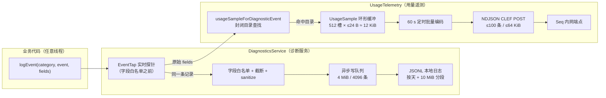

# Snow Shot 埋点上报集成规范（CLEF + 本地日志）

> 版本：1.0 · 更新日期：2026-11-10
> 读者：需要在自有应用中复刻该遥测能力的各应用团队
> 参考实现：`snow_shot/src/telemetry/`、`snow_shot/src/diagnostics/diagnostics.cpp`
> 关联文档：`docs/snow-shot-telemetry-schema.md`（Seq 数据字典）

本文档是**实现规范**而非设计说明。读完本文档，你应当能独立实现一条与 Snow Shot 等价的遥测链路：本地 JSONL 日志 + 批量 CLEF 上报 Seq。规范中的 MUST/SHOULD/MAY 约束以 RFC 2119 语气表述，均源自 Snow Shot 生产代码中已被验证的决策。

---

## 1. 设计哲学与架构总览

### 1.1 双通道设计理念

遥测系统同时维护两条**相互独立**的输出通道：

| 通道 | 格式 | 去向 | 用途 | 失败影响 |
|---|---|---|---|---|
| 本地日志 | JSONL（一行一个 JSON 对象） | `%APPDATA%\<App>\logs\<YYYY-MM-DD>\` | 现场排障、行为审计、离线取证 | 写盘失败不影响采集 |
| 批量上报 | CLEF（NDJSON） | 内网 Seq 服务器 | 产品看板、留存分析、聚合统计 | 网络失败静默丢弃 |

为什么两条都要：

1. **排障与分析的诉求不同**。排障需要 `pid/tid/sequence/source` 等诊断上下文和完整的原始 fields；分析只需要事件名 + 少量维度。把分析字段塞进诊断日志（或反之）会让两边都变臃肿。
2. **可用性解耦**。本地日志在无网络、Seq 不可达、内网权限受限时依然完整；批量上报在磁盘满、目录被杀软锁定时依然工作。两条链路任何一条失败，另一条继续。
3. **成本上限不同**。本地日志受磁盘配额约束（日 50 MiB、总 256 MiB）；上报受内存环形缓冲约束（12 KiB），对每周截一张图的用户和全天工作的用户成本一致。
4. **隐私边界不同**。本地日志经过字段白名单 + 512 字符截断 + sanitize（抹去疑似敏感内容）；上报只传输封闭目录中的枚举维度，天然不携带用户内容。

### 1.2 架构图



关键点：**一次 `logEvent()` 调用，两条链路分叉于同一个观察点（EventTap）**。EventTap 拿到的 fields 是调用方构造的原始对象，未经任何白名单过滤——这是第 1.3 节的核心约束。

### 1.3 关键约束：字段白名单只在本地编码时生效

这是本规范最重要的 MUST，直接源自 Snow Shot 的生产教训：

> **MUST**：EventTap（以及下游 Seq 侧）拿到的 fields 必须是调用方构造的原始对象；字段白名单（deny-by-default 的 `QSet`）只应作用于本地 JSONL 编码路径。

背景：`diagnostics.cpp` 的本地编码器维护一张约 95 个键的白名单，用于阻止用户内容（文本、图片、路径）进入落盘日志。若白名单错误地作用于 EventTap 之前，所有新维度（如 `tool`/`surface`）都会在本地日志显示为 `"fields": {}`，但 Seq 侧（走 EventTap）字段一直正确——**两条链路字段不一致**，极易误导排查方向。Snow Shot 曾因此排查数小时。

实现方式（C++ 侧 `record()` 内部顺序）：

```cpp
// diagnostics.cpp record() —— 简化
void record(...) {
    // 1. EventTap 交付：刻意放在 running/stopping 门与队列锁之前
    deliverToEventTap(level, category, event, fields);   // ← 原始 fields
    // 2. 本地编码：白名单只在这里生效
    QJsonObject safeFields;                              // ← 白名单过滤后的 fields
    for (auto it = fields.begin(); it != fields.end(); ++it)
        if (allowed.contains(it.key())) safeFields.insert(...);
    enqueueForDisk(... safeFields ...);
}
```

EventTap 交付点刻意位于「running/stopping 门与队列锁之前」：即使日志目录已损坏、写线程已停，用量计数依然工作。

### 1.4 资源预算总表

所有数字都是**上限**而非目标：

| 预算项 | 值 | 来源常量 |
|---|---|---|
| 环形缓冲容量 | 512 槽 × ≤24 B ≈ 12 KiB | `kRingCapacity = 512` |
| 单次上报样本数 | ≤ 100 | `kMaxSamplesPerRequest` |
| 单次请求体 | ≤ 64 KiB（按整条记录切割） | `kMaxBodyBytes` |
| 首次上报延迟 | 20 s | `firstFlushDelay` |
| 上报间隔 | 60 s | `flushInterval` |
| 单次传输超时 | 10 s | `transferTimeout` |
| 重试基delay / 上限 | 60 s × 2ⁿ，封顶 30 min，n ≤ 5 | `kRetryBaseMs` / `kRetryMaxMs` |
| 退出时最终投递预算 | 500 ms | `kShutdownBudgetMs` |
| 内存写队列 | 4 MiB / 4096 条 | `queueBytes` / `queueRecords` |
| 单日志文件 | 10 MiB | `segmentBytes` |
| 单日日志总量 | 50 MiB | `dailyBytes` |
| 全目录日志总量 | 256 MiB | `totalBytes` |

**设计基调**：遥测允许丢失，不允许阻塞。任何一条路径（缓冲满、网络失败、写盘失败）的失败策略都是「丢弃 + 计数 + 继续」，绝不回压业务线程。

---

## 2. 数据模型定义

### 2.1 UsageSample 结构体契约

环形缓冲跨线程传递事件样本，因此样本必须是无指针的平凡可拷贝类型：

```cpp
// usageevents.h —— 生产代码原文
struct UsageSample {
    qint64 epochMs = 0;                    // 8 B
    UsageEvent event = UsageEvent::Count;      // 1 B
    UsageOutcome outcome = UsageOutcome::Unknown;   // 1 B
    UsageFeature feature = UsageFeature::None;      // 1 B
    UsageTool tool = UsageTool::Unknown;            // 1 B
    UsageSurface surface = UsageSurface::Unknown;   // 1 B
};
static_assert(std::is_trivially_copyable_v<UsageSample>);
static_assert(sizeof(UsageSample) <= 24, "samples must stay tiny; they live in a fixed ring");
```

**为什么用 `quint8` 枚举而不是字符串**：

1. **零分配**：字符串样本每次入队都要堆分配并参与锁竞争；枚举样本是纯内存拷贝，`recordSample()` 在互斥锁内只有一次 `samples[head++] = sample`。
2. **跨线程安全**：`trivially_copyable` 允许生产者线程（任意业务线程）与消费者线程（定时器线程/主线程事件循环）之间用 `std::memcpy` 语义传递，无析构竞争。
3. **封闭目录强制校验**：事件名与维度值是编译期闭合的集合。不认识的字段在目录查找阶段就被丢弃（`return std::nullopt`），不存在「字符串拼错导致静默脏数据」。
4. **缓冲可预算**：512 × 24 B 的上限意味着遥测内存占用恒定，与用户行为量无关。

**各语言等效约束**：

- C++：`static_assert(std::is_trivially_copyable_v<T>)` + `sizeof(T) <= 24`
- Rust：`#[derive(Clone, Copy)]` 且全部字段为定长标量（`i64` + `u8`），不用 `String`/`Box`
- Python/Go 等无此约束的语言：以「样本可哈希、可深拷贝、无对象引用」近似，或直接用 `dataclass(frozen=True)` / 纯 struct

### 2.2 枚举类型总表

Snow Shot 定义 5 个 `quint8` 枚举（`usageevents.h`）：

**UsageEvent（25 个事件 + Count 哨兵）**——见附录 A 完整表。

**UsageOutcome（4 + Unknown）**

| 枚举值 | 上报值 | 说明 |
|---|---|---|
| `Unknown` | （省略字段） | 默认；CLEF 中不出现 Outcome 字段 |
| `Succeeded` | `succeeded` | 操作成功 |
| `Failed` | `failed` | 操作失败 |
| `Cancelled` | `cancelled` | 用户取消 |
| `Rejected` | `rejected` | 被拒绝（如固定窗口被拒） |

**UsageFeature（5 + None）**——注意：Feature **仅**随 `api.request_finished` 事件出现，语义是「AI 后端请求的用途」：

| 枚举值 | 上报值 | 对应 request_kind |
|---|---|---|
| `None` | （省略字段） | `request_kind` 为空 |
| `Translation` | `translation` | `translation` |
| `TableExtraction` | `table_extraction` | `table_extract` / `table_vision_extract` |
| `LatexExtraction` | `latex_extraction` | `latex_extract` / `latex_vision_extract` |
| `ImageConversion` | `image_conversion` | `image_conversion` |
| `Other` | `other` | （保留） |

**UsageTool（21 + Unknown + Count）**

| 枚举值 | 上报值 | 枚举值 | 上报值 |
|---|---|---|---|
| `Select` | `select` | `SerialNumber` | `serial_number` |
| `Shape` | `shape` | `PenFilter` | `pen_filter` |
| `Arrow` | `arrow` | `Spotlight` | `spotlight` |
| `Line` | `line` | `AutoFilter` | `auto_filter` |
| `FreeDraw` | `free_draw` | `RectangleEraser` | `rectangle_eraser` |
| `RectangleHighlight` | `rectangle_highlight` | `BrushEraser` | `brush_eraser` |
| `PenHighlight` | `pen_highlight` | `Distance` | `distance` |
| `Eraser` | `eraser` | `Angle` | `angle` |
| `RectangleFilter` | `rectangle_filter` | `Magnifier` | `magnifier` |
| `Watermark` | `watermark` | `SpeechBubble` | `speech_bubble` |
| `Text` | `text` | `Unknown` | （样本被丢弃） |

**UsageSurface（3 + Unknown + Count）**

| 枚举值 | 上报值 | 说明 |
|---|---|---|
| `Capture` | `capture` | 截图浮层 |
| `Pinned` | `pinned` | 固定到屏幕 |
| `ImageEditing` | `image_editing` | 图像编辑窗口 |
| `Unknown` | （容忍，仍上报） | 界面维度缺失时事件依然有效 |

### 2.3 枚举 → snake_case 字符串转换（三语言示例）

所有上报值统一 snake_case。转换函数必须**穷尽枚举**（无 default 分支）：上游新增枚举值时此处编译失败，而不是静默漏报。

C++（Qt，生产实现摘自 `usageevents.cpp`）：

```cpp
QString usageSurfaceName(UsageSurface surface) {
    switch (surface) {
    case UsageSurface::Capture:      return QStringLiteral("capture");
    case UsageSurface::Pinned:       return QStringLiteral("pinned");
    case UsageSurface::ImageEditing: return QStringLiteral("image_editing");
    case UsageSurface::Unknown:      // Unknown/Count 是哨兵，返回空
    case UsageSurface::Count:        break;   // 故意不写 default
    }
    return {};
}
```

Rust（等效实现，借助编译期穷尽性检查）：

```rust
#[derive(Clone, Copy, PartialEq, Eq)]
#[repr(u8)]
pub enum UsageSurface { Unknown = 0, Capture = 1, Pinned = 2, ImageEditing = 3 }

pub fn usage_surface_name(surface: UsageSurface) -> Option<&'static str> {
    match surface {
        UsageSurface::Capture      => Some("capture"),
        UsageSurface::Pinned       => Some("pinned"),
        UsageSurface::ImageEditing => Some("image_editing"),
        UsageSurface::Unknown      => None,   // 哨兵：省略字段
    }  // match 天然穷尽，新增变体时此处编译失败
}
```

Python（用字典映射 + 显式哨兵检查，字典必须由枚举驱动而非手写常量）：

```python
from enum import IntEnum

class UsageSurface(IntEnum):
    UNKNOWN = 0
    CAPTURE = 1
    PINNED = 2
    IMAGE_EDITING = 3

_SURFACE_NAMES: dict[UsageSurface, str] = {
    UsageSurface.CAPTURE: "capture",
    UsageSurface.PINNED: "pinned",
    UsageSurface.IMAGE_EDITING: "image_editing",
}  # UNKNOWN 有意缺席 → 省略字段

def usage_surface_name(surface: UsageSurface) -> str:
    return _SURFACE_NAMES.get(surface, "")
```

---

## 3. CLEF 上报协议详解

### 3.1 单条记录的 14 个字段

每条上报记录是一个 CLEF（Compact Log Event Format）JSON 对象：

| 字段 | 类型 | 必填 | 说明 | 示例 |
|---|---|---|---|---|
| `@t` | ISO8601 | MUST | 事件时刻，**UTC**，毫秒精度 | `2026-11-10T05:12:34.567Z` |
| `@mt` | string | MUST | 消息模板，固定 `SnowShot usage {EventName}`，保证 Seq 原生渲染可读 | — |
| `@l` | string | MUST | 日志级别，固定 `Information` | `Information` |
| `AppName` | string | MUST | 应用名（每个团队固定一个值） | `SnowShot` |
| `UserId` | string | MUST | 稳定用户标识（见 §7.4） | `air14` |
| `Date` | date | MUST | **当地时区**日期（与 `@t` 的 UTC 可能不同日） | `2026-11-10` |
| `EventName` | string | MUST | 事件名，snake_case，取值见附录 A | `annotation.stroke_committed` |
| `Count` | int | MUST | 固定 `1`（Seq 侧聚合用占位） | `1` |
| `AppVersion` | string | MAY | 版本号，空则省略 | `1.4.2` |
| `SessionId` | string | MAY | 会话 ID，空则省略 | `178dbc09-e241-…` |
| `Outcome` | string | MAY | `succeeded`/`failed`/`cancelled`/`rejected`，Unknown 省略 | `succeeded` |
| `Feature` | string | MAY | 仅 `api.request_finished` 携带，见 §2.2 | `translation` |
| `Tool` | string | MAY | 仅标注事件携带，见 §2.2 | `arrow` |
| `Surface` | string | MAY | 仅标注事件携带，见 §2.2 | `capture` |

条件性字段的 MUST 规则：**空值一律省略字段本身**，不要上报 `""` 或 `null`——Seq 侧按「字段存在与否」过滤，空字符串会造成假分组。

`Date` 的时区语义（常见错误点）：`Date = moment.date()`，其中 `moment` 是**本地时区**的 QDateTime；`@t = moment.toUTC()`。一条 UTC 时间 16:30 的事件在中国时区的 `Date` 是当天、在纽约是前一天。按天聚合必须用 `Date` 而不是 `@t` 派生。

### 3.2 上报端点与请求接口规范

**生产端点**：

```
POST https://desktop.cqczy.cn/seq/api/events/raw?clef
```

定义于 `usagetelemetry.h` 的 `Options::endpoint` 默认值，是**有意硬编码**：

```cpp
// The internal Seq collector. Hard-coded on purpose: it is a company intranet endpoint,
// provisioned per deployment, and this is the single sanctioned exception to the
// "never hard-code endpoints" rule. Tests override it with a loopback URL.
QUrl endpoint = QUrl(QStringLiteral("https://desktop.cqczy.cn/seq/api/events/raw?clef"));
```

> 仓库「禁止硬编码端点/密钥」规则的**唯一特批例外**：内网采集地址按部署环境提供，收敛在唯一源位置避免配置漂移；单元测试以 loopback URL 覆盖该默认值。

**URL 构成**：

| 部分 | 生产值 | 说明 |
|---|---|---|
| scheme | `https` | MUST 使用 TLS，明文端点禁止 |
| host | `desktop.cqczy.cn` | 公司内网 Seq 实例；新团队接入时替换为自己实例的 host，路径不变 |
| path | `/seq/api/events/raw` | Seq 标准 **Raw Events Ingestion** API（Seq 5.1+）；`/seq` 前缀来自反向代理部署路径 |
| query | `?clef` | 声明请求体为 CLEF NDJSON 格式 |

自建 Seq 的团队换 host 即可复用整条链路；使用非 Seq 采集器时，按 §3.2–§3.5 实现等价的 NDJSON CLEF 接收端。

**认证**：生产链路无 Authorization 头——内网 Seq 配置为匿名写入（信任内网边界）。若你的 Seq 启用 API Key，标准方式是请求头 `X-Seq-ApiKey: <key>`；**MUST NOT** 把 key 拼进 URL 查询参数。

**完整 HTTP 事务**（请求体见 §3.3）：

```http
POST /seq/api/events/raw?clef HTTP/1.1
Host: desktop.cqczy.cn
Content-Type: application/vnd.serilog.clef
Accept: application/json

{"@t":"2026-11-10T05:12:34.567Z","@mt":"SnowShot usage {EventName}","@l":"Information","AppName":"SnowShot","UserId":"air14","Date":"2026-11-10","EventName":"annotation.tool_selected","Count":1,"AppVersion":"1.4.2","SessionId":"178dbc09-e241-44cc-8f8e-43e221b446c8","Tool":"arrow","Surface":"capture"}
{"@t":"2026-11-10T05:12:41.203Z","@mt":"SnowShot usage {EventName}","@l":"Information","AppName":"SnowShot","UserId":"air14","Date":"2026-11-10","EventName":"annotation.stroke_committed","Count":1,"Tool":"arrow","Surface":"capture"}
```

成功响应（Seq 典型返回 `201 Created`；客户端契约是 **2xx 即成功**，不解析响应体）：

```http
HTTP/1.1 201 Created
Content-Length: 0
```

**Options 默认值**（`usagetelemetry.h`，除 endpoint 外）：

| 参数 | 默认值 | 说明 |
|---|---|---|
| `firstFlushDelay` | 20 s | 启动后首次 flush 延迟，给启动高峰让路 |
| `flushInterval` | 60 s | 常规 flush 周期（single-shot timer 自链） |
| `transferTimeout` | 10 s | 单次请求传输超时 |
| `useSystemProxy` | `false` | 详见 §3.5 |
| `enabled` | `true` | `false` 时 `start()` 返回 `false`，进程零外发流量 |
| `userId` | 空 → 派生 | 默认取 profile 目录名（见 §7.4） |
| `appName` | 空 → `SnowShot` | 应用名维度 |

start/stop 生命周期接线模板见 §6.0。

### 3.3 请求体格式：NDJSON（非数组）

Snow Shot 使用**换行分隔 JSON**：每行一个完整 CLEF 对象，行间以 `\n` 连接，**无尾随换行**。批量在整条记录边界切割，请求体永不以半个 JSON 结尾：

```
{"@t":"2026-11-10T05:12:34.567Z","@mt":"SnowShot usage {EventName}","@l":"Information","AppName":"SnowShot","UserId":"air14","Date":"2026-11-10","EventName":"annotation.tool_selected","Count":1,"AppVersion":"1.4.2","SessionId":"178dbc09-e241-44cc-8f8e-43e221b446c8","Tool":"arrow","Surface":"capture"}
{"@t":"2026-11-10T05:12:41.203Z","@mt":"SnowShot usage {EventName}","@l":"Information","AppName":"SnowShot","UserId":"air14","Date":"2026-11-10","EventName":"annotation.stroke_committed","Count":1,"Tool":"arrow","Surface":"capture"}
```

HTTP 头：

```
POST <endpoint> HTTP/1.1
Content-Type: application/vnd.serilog.clef
Accept: application/json
```

> 说明：Seq 的 ingestion 端点同时接受 NDJSON CLEF 与 JSON 数组两种包装。规范采用 NDJSON，理由是编码器可以流式拼接、单条记录损坏不会破坏整批。团队如需数组包装（`[{...},{...}]`），须与服务端约定一致后固定下来。

### 3.4 服务端预期响应与重试策略

| 响应 | 处理 | 本批样本 |
|---|---|---|
| 2xx | 成功，重置退避计数，记录恢复沿 | 已消费 |
| 4xx（除 408/429） | `noteFailure("rejected_NNN")` | **丢弃，不重试**（payload 再次发送仍会被拒） |
| 408 / 429 / 5xx / 网络错误 | `noteFailure(errorString)` | **丢弃，不回灌**（见下） |

**丢弃语义（有意为之）**：批量样本在发送前已从环形缓冲 `take` 出来，请求失败后**不回灌**。理由是避免头部阻塞——一批坏样本永远堵在队首会让后续所有数据饿死。遥测的契约是允许丢失，方向是「尽力而为的尾部一致性」。

**为什么不做持久化重放**（`usagetelemetry.h` 头注释的决策论证）：批次没有去重键，歧义失败后重放会把事件记两遍——少计只是把用量趋势压平，重复计却是系统性虚增，因此宁丢不重。60 s flush 窗口同时限定了最坏丢失量：包括跳过 `aboutToQuit` 的硬关机在内，最多丢最近一个窗口的样本。原文：

```text
Failures are dropped rather than persisted. A batch has no de-duplication key, so
replaying it after an ambiguous failure would double-count; undercounting only flattens
usage trends, while double-counting would systematically inflate them. The 60 s flush
window bounds the worst-case loss, including a hard shutdown that skips aboutToQuit.
```

**指数退避**：

```
delay = min(60 s × 2^(failures-1), 30 min)，shift 上限 5
序列：60 s → 120 s → 240 s → 480 s → 960 s → 1920 s → 封顶 1800 s
```

退避期间的定时 tick 继续跑，但 `flush()` 直接返回（`now < nextAttemptMs`），缓冲照常累积。

**告警沿触发**：`telemetry.flush_failed`（Warning 级）只在「健康 → 故障」沿记录一条；持续失败不重复记录，避免一个永久不可达端点刷爆日志。恢复时记 `telemetry.flush_recovered`。这两个事件名不在用量目录 `kRules` 中，不会反馈进上报器（无自指循环）。

**single-flight**：同一时刻至多一个在途请求。`flush()` 发现 `m_reply` 非空即返回，该窗口样本留给下一批。请求频率是时钟的属性，与用户行为量无关。

### 3.5 代理与 TLS

- 默认**不使用**系统代理；仅当用户显式开启「使用系统代理」时启用 `systemProxyForQuery`。
- **MUST NOT** 弱化证书校验（禁用证书验证开关、忽略 TLS 错误）。遥测端点在内网，代理穿透靠系统代理配置而不是绕过校验。
- 该策略与业务 API 客户端保持一致（Snow Shot 中 `SystemNetworkProxyFactory` 镜像 `SnowShotApiClient` 的行为），避免「遥测能通、业务不通」的排障分裂。

---

## 4. 本地日志格式

### 4.1 JSONL 单行结构

每条本地日志记录是一个单行 JSON 对象（一行一个事件，文件内按写入顺序排列）：

```json
{
  "time": "2026-11-10T13:22:31.512",
  "level": "info",
  "category": "snow_shot.annotation",
  "event": "annotation.stroke_committed",
  "pid": 21324,
  "tid": "9052",
  "session": "178dbc09-e241-44cc-8f8e-43e221b446c8",
  "sequence": 42,
  "message": "",
  "fields": {"tool": "arrow", "surface": "capture"}
}
```

| 字段 | 类型 | 说明 |
|---|---|---|
| `time` | ISO8601（本地） | 写入时刻 |
| `level` | string | `debug`/`warning`/`critical`/`fatal`/`info` |
| `category` | string | 截断至 128 字符，约定 `snow_shot.<feature>` |
| `event` | string | 截断至 128 字符，snake_case |
| `pid` / `tid` | int / string | 进程 / 线程标识 |
| `session` | string | 会话 UUID（与 CLEF `SessionId` 同源） |
| `sequence` | int | 进程内单调递增序号 |
| `message` | string | 截断至 8192 字符 + sanitize |
| `fields` | object | 白名单过滤后的元数据（见 §4.2） |
| `source` | string | 可选，代码位置（截断 512） |

字符串统一经过 `sanitize()`：抹除疑似 token/密钥/用户路径的模式。

### 4.2 字段白名单机制

本地编码器维护一张 **deny-by-default** 白名单（`static const QSet<QString> allowed`，生产代码约 95 个键）：

- **只放行元数据**：注释原文是「Callers supply metadata only; deny content-bearing keys as a second boundary」。白名单的存在使得即使某个调用点误传用户内容（截图文本、选区坐标以外的内容），落盘文件也不会包含它。
- **拒绝复合值**：`isObject() || isArray()` 的字段一律丢弃，fields 只允许标量。
- **字符串二次防护**：放行的字符串值截断至 512 字符后再过 sanitize。

常用白名单键（按主题分组，完整列表以 `diagnostics.cpp` 为准）：

| 主题 | 键 |
|---|---|
| 标注维度（本次新增） | `tool`, `surface` |
| 结果与耗时 | `outcome`, `duration_ms`, `reason`, `code`, `status`, `operation`, `stage` |
| 图像与采集 | `format`, `pixel_format`, `width`, `height`, `expected_width`, `expected_height`, `dpr`, `stride_bytes`, `x`, `y`, `scale` |
| 录制 | `mode`, `codec`, `fps`, `quality`, `encoding_preset`, `start_us`, `end_us`, `speed_percent`, `export_attempt` |
| OCR | `initialization_ms`, `inference_ms`, `render_ms`, `count`, `cache_hit` |
| API | `request_kind`, `backend` |
| 会话与环境 | `version`, `revision`, `build`, `qt`, `os`, `arch` |

> **新增维度键时 MUST**：同时更新白名单。否则该字段在本地日志显示为空、在 Seq 侧正常——正是 §1.3 描述的双链路不一致。

### 4.3 日志轮转策略

| 策略 | 规则 |
|---|---|
| 目录结构 | `<logs根>/YYYY-MM-DD/snow-shot-<会话哈希>-<6位序号>.log`，按天归档 |
| 单文件切割 | 达到 10 MiB（`segmentBytes`）滚动到 `-000002.log` 等新段 |
| 跨天切换 | 日期变化时关闭当前文件并新建当日目录；记录 `session.date_changed` |
| 并发保护 | `QLockFile`（`<file>.lock`），多进程只允许一个写者持有活动文件 |
| 触发维护的时机 | 滚动完成 / 时间跳变 / 跨天 / 每 15 分钟 / 文件达上限，任一即进入维护窗口 |
| 总量控制 | 日 50 MiB、全目录 256 MiB，维护窗口内清理旧文件 |
| 写队列 | 4 MiB / 4096 条内存队列 + 后台写线程；队列满按丢弃策略让位 |

> 队列锁纪律（生产注释原文）：用量计数（EventTap）刻意排在「running/stopping 门与队列锁」之前——日志目录死亡不能带走遥测；外部观察者也不能通过制造写盘压力来扩大临界区或影响队列丢弃策略。


---

## 5. 事件注册与规则配置

### 5.1 kRules：诊断事件 → 用量目录的映射表

`usageevents.cpp` 中的 `kRules` 是整个遥测系统的**目录入口**：一行一条，把诊断事件名映射到 `UsageEvent` 枚举值。它的价值在于——任何已经在打诊断日志的功能，只需在这里加一行就变成可统计的事件，**打点处、上传器、数据模型零改动**：

```cpp
// One row per diagnostics event the catalogue counts. Any feature that already records a
// diagnostics event therefore becomes measurable by adding a single line here, with no
// change to the recording sites and no extra work in the uploader.
constexpr std::array<EventRule, 26> kRules{{
    {"session.unexpected_termination", UsageEvent::SessionUnexpectedTermination},
    {"capture.finished",               UsageEvent::CaptureFinished},
    {"scrolling.started",              UsageEvent::ScrollingStarted},
    {"annotation.tool_selected",       UsageEvent::AnnotationToolSelected},
    {"annotation.stroke_committed",    UsageEvent::AnnotationStrokeCommitted},
    // ... 共 26 条，完整列表见附录 A
}};
```

注意 `kRules` 允许**多对一**：`recording.failed` 与 `recording.render_failed` 都映射到 `RecordingFailed`；`print.capture_failed` / `print.snapshot_failed` / `print.pinned_failed` 都映射到 `PrintFailed`。枚举是「分析口径」，诊断事件名是「现场口径」，二者不必一一对应。

### 5.2 热路径过滤顺序

`usageSampleForDiagnosticEvent()` 的过滤顺序是**性能契约**，不要打乱（便宜的字符串测试在前，线性目录查找在后）：

```cpp
std::optional<UsageSample> usageSampleForDiagnosticEvent(...) noexcept {
    if (level == QtDebugMsg)          return std::nullopt;  // 1. debug 级全丢弃
    if (event == "qt.message")        return std::nullopt;  // 2. Qt 日志噪声（数量最多）先挡掉
    if (!category.startsWith(prefix)) return std::nullopt;  // 3. 非本应用类别丢弃
    // 4. kRules 线性查找（26 条），未命中即返回
    // 5. 命中后按事件类型提取维度字段（见 5.3）
}
```

1、2 两条必须排在目录查找之前：诊断 handler 把每条 Qt 日志都以 `qt.message` 转进 `record()`，这是到达探针的最大流量；而目录查找对它们永远不命中，提前拦截省掉整个扫描。

### 5.3 维度字段的严格性分级

目录命中后，从原始 fields 提取维度。不同维度的容错策略不同：

| 维度 | 提取规则 | 未知值处理 | 理由 |
|---|---|---|---|
| `Outcome` | 读 `outcome` 字段 | 映射到 `Unknown`（字段省略） | 结果维度缺失不改变事件本身 |
| `Feature`（API） | 读 `request_kind` | **丢弃整个样本**；`chat_models`（模型目录刷新）明确映射为丢弃 | 无关请求会污染请求计数 |
| `Tool`（标注） | 读 `tool` 字段 | **丢弃整个样本** | 没有工具的标注事件无法区分来源，匿名上传无意义 |
| `Surface`（标注） | 读 `surface` 字段 | 映射到 `Unknown`（仍上报） | 界面是 nice-to-have 维度 |

> 原则：**缺失后事件失去分析价值的维度 → 丢弃样本；仅失去分组能力的维度 → 容忍 Unknown**。实现时把这个决策写进函数注释。

### 5.4 新增一个事件的完整步骤

以「新增 `annotation.stroke_committed`」为例，四步：

```
① usageevents.h    : UsageEvent 枚举加 AnnotationStrokeCommitted（在 Count 之前）
② usageevents.cpp  : kRules 加 {"annotation.stroke_committed", UsageEvent::AnnotationStrokeCommitted}
③ usageevents.cpp  : usageEventName() 加 case AnnotationStrokeCommitted: return "annotation.stroke_committed";
④ 业务接线处        : diagnostics::logEvent("snow_shot.annotation", "annotation.stroke_committed", fields);
```

配套检查（MUST）：

- 若事件带新维度键（如 `tool`）：同步更新 §4.2 的本地白名单。
- 若新增维度枚举：`usageToolName()`/`usageSurfaceName()` 加穷尽 case；引擎枚举 → 用量枚举的映射函数（如 `toolForCanvasTool`）同样穷尽无 default。
- `trackedDiagnosticEvents()` 会自动反映 `kRules`，测试用它做目录完整性断言。
- **MUST NOT** 修改已上线事件的 snake_case 名称或维度值——Seq 侧看板与历史数据按字符串分组，改名等于新事件。

### 5.5 单例陷阱：测试必须用 `DiagnosticsService::instance()`

**MUST**：验证落盘/上报行为的测试一律使用全局单例，不得自建服务实例。

原因：`logEvent()` 自由函数内部硬编码转发到 `DiagnosticsService::instance()`。测试里自建 `DiagnosticsService service;` 并 `initialize()` 后，业务代码的 `logEvent()` 依然走单例——自建实例的导出文件里只有启动事件，业务事件一条不落。Snow Shot 在 `reportedDimensionsSurvivePersistence()` 测试上踩过此坑：

```cpp
// 错误：自建实例收不到 logEvent() 的流量
snow_shot::diagnostics::DiagnosticsService service;
service.initialize(options);
reportAnnotationStrokeCommitted(...);           // → instance()，不是 service

// 正确：走单例
auto& service = snow_shot::diagnostics::DiagnosticsService::instance();
service.initialize(options);                    // 测试结束后 shutdown() 还原
```

---

## 6. 接口接线指南

六类业务场景 + 一类生命周期接线的模板。通用规则先行：

- **MUST** `noexcept`/`try-catch` 包裹：遥测绝不允许向业务路径抛异常（Snow Shot 注释原文：「Telemetry must never propagate into the drawing path」）。
- **MUST** 只传标量元数据（strings/numbers/bools），禁嵌套对象/数组（白名单也会拒绝）。
- fields 值统一 snake_case，与目录（§5.3）的解析严格对齐。
- category 约定 `snow_shot.<feature>`，event 用 `snake_case.verb_noun` 或 `noun_verb`。

### 6.0 应用启动与关闭接线

遥测生命周期在 `main.cpp` 的接线模式：**构造即装探针 + aboutToQuit 显式 stop（幂等兜底）**：

```cpp
// 1. 构造即安装探针：早于业务初始化，保证启动期事件也被计数
struct TelemetryLifetime {
    TelemetryLifetime() { snow_shot::telemetry::installDiagnosticTap(); }
    ~TelemetryLifetime() { snow_shot::telemetry::stop(); }  // 幂等，兜底
} telemetryLifetime;

// 2. aboutToQuit 显式 stop：在 QApplication 销毁前，网络栈与事件循环仍可用；
//    析构兜底的第二次 stop() 是 no-op
QObject::connect(&app, &QCoreApplication::aboutToQuit, &app,
                 [] { snow_shot::telemetry::stop(); }, Qt::DirectConnection);

// 3. 单实例赢家才 start()：被转发的二次启动不贡献任何样本（避免重复计数）
static_cast<void>(snow_shot::telemetry::start({
    .userId = {},                    // 空 → 默认派生（profile 目录名）
    .appName = snow_shot::app::edition::registryName(),
    .appVersion = QStringLiteral(SNOW_DIAGNOSTICS_VERSION),
    .sessionId = diagnostics.status().sessionId,   // 与本地日志同源
    .useSystemProxy = /* 设置项 network/proxy == "system" */,
}));
```

要点：

- `start()` 主线程专用、幂等；`enabled=false` 时直接返回 `false`，完全静默。
- **运行时热切换代理**：`network/proxy` 设置变更时同步调 `telemetry::setUseSystemProxy(bool)`；该同步与更新服务的代理设置相互独立——采集器跟随同一设置，即使该构建没有更新服务。
- stop 的 500 ms 预算与投递序列见 §7.2；端点与 Options 默认值见 §3.2。

### 6.1 工具选中（按钮点击）

```cpp
// 位置：工具栏命令处理器（如 screenshottoolcommandworkflow.cpp 的 setActiveTool）
void ScreenshotToolCommandWorkflow::setActiveTool(ScreenshotActiveTool tool, UsageSurface surface) {
    // ……业务逻辑：切换引擎工具、更新 UI……
    telemetry::reportAnnotationToolSelected(engineTool, surface);   // 内部自带去重
}
```

```cpp
// 模块封装（annotationusage.cpp 模式）：去重 + try/catch 集中在一处
void reportAnnotationToolSelected(SnowCanvasTool tool, UsageSurface surface) noexcept {
    const auto slot = static_cast<std::size_t>(surface);
    if (slot < selectedTool.size()) {
        const unsigned current = static_cast<unsigned>(tool);
        if (selectedTool[slot].exchange(current) == current)
            return;                    // 同界面重复选中同一工具 → 静默丢弃
    }
    reportAnnotationEvent(tool, surface, /*stroke=*/false);
}
```

去重理由：工具栏从不清空选中态，「重复点击当前工具」是最高频噪声，不去重会把真实活动挤出 512 槽环形缓冲。去重槽用 `std::atomic<unsigned>` 按 Surface 分槽，无锁。

### 6.2 落笔提交（Canvas stroke committed）

引擎回调出（`snow_canvas_widget.cpp` 模式）——按下时记起点与工具，抬笔时校验文档确实变更了才回调：

```cpp
// 按下（mousePress / tabletPress 两处都要）
void beginStrokeTracking() {
    strokeTracking = false;
    if (!strokeCommitted) return;
    strokeStartRevision = documentRevision();   // 记起点
    strokeTool = canvasTool();                  // 记工具（抬笔时可能已切走）
    strokeTracking = true;
}

// 抬笔
void finishStrokeTracking() {
    if (!strokeTracking) return;
    strokeTracking = false;
    const auto handler = strokeCommitted;       // 拷贝：handler 可能销毁本 widget
    const SnowCanvasTool tool = strokeTool;
    if (!handler || tool == SnowCanvasTool::Select) return;   // 选择工具不算落笔
    if (documentRevision() <= strokeStartRevision) return;    // 文档未变（如点击）不算落笔
    handler(tool);
}
```

宿主侧（业务模块）：

```cpp
canvas->setStrokeCommittedHandler([this](SnowCanvasTool tool) {
    telemetry::reportAnnotationStrokeCommitted(tool, UsageSurface::Capture);  // 不去重，每次都报
});
```

要点：**事件驱动语义在引擎层判定，上报在宿主层执行**——引擎库不依赖遥测模块，只暴露一个 `std::function<void(Tool)>` 回调；「revision 未变化不算落笔」挡掉纯点击；Select 工具明确排除。

### 6.3 OCR 识别成功/失败

```cpp
// 位置：OCR 服务（screenshotocrrecognitionservice.cpp 模式）
void onOcrSubmitted() {
    diagnostics::logEvent(QStringLiteral("snow_shot.ocr"),
                          QStringLiteral("ocr.submitted"));
}
void onOcrFinished(bool ok) {
    QJsonObject fields;
    fields.insert(QStringLiteral("outcome"),
                  ok ? QStringLiteral("succeeded") : QStringLiteral("failed"));
    diagnostics::logEvent(QStringLiteral("snow_shot.ocr"),
                          QStringLiteral("ocr.finished"), fields);
}
void onOcrCancelled() {
    diagnostics::logEvent(QStringLiteral("snow_shot.ocr"),
                          QStringLiteral("ocr.cancelled"));
}
```

三个动作三事件，而不是一个事件带 outcome——`submitted`（漏斗入口）与 `finished`（转化出口）分开才能算成功率。

### 6.4 截图保存 / 导出

```cpp
// 位置：导出完成回调
QJsonObject fields;
fields.insert(QStringLiteral("outcome"),
              result.ok ? QStringLiteral("succeeded")
                        : (result.cancelled ? QStringLiteral("cancelled")
                                            : QStringLiteral("failed")));
fields.insert(QStringLiteral("format"), result.formatName);   // 白名单键
diagnostics::logEvent(QStringLiteral("snow_shot.export"),
                      QStringLiteral("export.image_finished"), fields);
```

### 6.5 录制开始 / 结束

```cpp
diagnostics::logEvent(QStringLiteral("snow_shot.recording"),
                      QStringLiteral("recording.started"));
// ……录制中……
diagnostics::logEvent(QStringLiteral("snow_shot.recording"),
                      QStringLiteral("recording.export_finished"), outcomeFields);
// 失败路径分两条诊断事件，共用一个用量枚举（多对一）：
diagnostics::logEvent(QStringLiteral("snow_shot.recording"),
                      QStringLiteral("recording.failed"), failureFields);
diagnostics::logEvent(QStringLiteral("snow_shot.recording"),
                      QStringLiteral("recording.render_failed"), failureFields);
```

### 6.6 API 调用结果

```cpp
// 位置：HTTP 客户端统一出口（如 snowshotapiclient.cpp 的 finish*）
QJsonObject fields;
fields.insert(QStringLiteral("request_kind"), kind);   // translation / table_extract / …
fields.insert(QStringLiteral("duration_ms"), elapsedMs);
fields.insert(QStringLiteral("outcome"), ok ? QStringLiteral("succeeded")
                                           : QStringLiteral("failed"));
diagnostics::logEvent(QStringLiteral("snow_shot.network"),
                      QStringLiteral("request.finished"), fields);
```

`request_kind` 取值必须与目录侧 `featureFromRequestKind()` 严格对齐；不在映射表内的 kind（如 `chat_models` 模型目录刷新）返回 `nullopt`，样本整体丢弃——否则无关请求会主导请求计数。

---

## 7. 跨语言移植注意事项

### 7.1 内存安全

- 样本结构体序列化后 **MUST ≤ 24 字节**（C++：`static_assert(sizeof(T) <= 24)`），禁止 `std::string`/`QString`/`Vec` 等堆引用字段。字符串维度在**编码阶段**（上传线程）才物化，环形缓冲里只有枚举。
- Rust 侧：`#[repr(u8)]` 枚举 + `i64`，结构体自动 `Copy`；用 `crossbeam` 的 MPMC 队列或 `Mutex<VecDeque<T>>` 均可，禁止 `Arc<Mutex<String>>` 样本。
- 环形缓冲满时的丢弃方向：**丢最新**而不是丢最旧（Snow Shot 注释：保住时间顺序的尾部一致性，发出去的批次内部自洽）。

### 7.2 线程安全

- 缓冲读写：一个 `std::mutex` 保护 `samples[] + head + dropped`，临界区内只有 memcpy 与计数递增。不要上读写锁——写操作本身就极短，`std::shared_mutex` 的开销反而更高。
- EventTap（探针）契约：`noexcept`、禁止阻塞、不得假设事件循环存在（工作线程与启动早期都会打事件）；探针内部可以再调 `logEvent()`（重入保护已在 record 入口设置）。
- 定时器：Snow Shot 用主线程事件循环（Qt `QTimer`），发送线程即 UI 线程但每 60 s 才工作一次。**MUST NOT** 用「每事件触发一次 flush」——请求率必须是时钟的属性（§3.4 single-flight）。无事件循环的运行时用独立工作线程 + 60 s sleep 等价实现。
- 退出路径：停定时器 → abort 在途请求 → 记 shutdown 事件 → 500 ms 预算内同步投递剩余缓冲 → 销毁网络对象。预算保证被挂死的端点不会拖住进程退出。

### 7.3 时区处理

- `@t`：**UTC ISO8601 毫秒精度**（`2026-11-10T05:12:34.567Z`）。
- `Date`：**当地时区日期**，供按天分组。UTC 16:30 在东八区是当天、在纽约是前一天，两个字段都必须保留。
- 环形缓冲里存 `epochMs`（UTC epoch 毫秒），编码时才派生 `@t` 与 `Date`——不要在打点线程做时区换算。

### 7.4 用户标识

**MUST** 确定性派生：同一设备同一用户永远得到同一个 `UserId`。**MUST NOT** 随机 UUID（每次启动都变，留存分析全废）。

Snow Shot 的默认派生是「用户主目录名」（Windows 读 `USERPROFILE` 的最后一段）。更稳妥的通用做法是「稳定机器/用户属性的哈希」：

```python
import hashlib, getpass, platform, socket
raw = f"{getpass.getuser()}@{socket.gethostname()}@{platform.system()}"
user_id = hashlib.sha256(raw.encode()).hexdigest()[:16]   # 截断即可，避免原文泄露用户名
```

哈希 vs 用户名的取舍：哈希防 `UserId` 泄露真实用户名；Snow Shot 用用户名是内网信任模型下的选择。新团队接入前 MUST 与隐私要求核对。

### 7.5 幂等性与去重

三个层次，缺一不可：

1. **客户端源头去重**（事件语义级）：`tool_selected` 这类「状态型」事件在客户端按 `(Surface, Tool)` 去重（§6.1），避免高频噪声；`stroke_committed` 这类「动作型」事件不去重。
2. **传输层不保证 exactly-once**：批量丢弃 + 不回灌（§3.4）意味着事件可能丢，但**不会**因重试而重复（失败批次直接丢弃，不重发）。
3. **服务端聚合去重**：Seq/看板侧按 `(UserId, Date, EventName[, Tool, Surface])` 聚合 `Count`。若引入带重发的传输（如带持久化队列的版本），MUST 给每条记录加事件级唯一 ID（如 `hash(sessionId, sequence)`），服务端按 ID 去重。

---

## 8. 调试与验证清单

### 8.1 本地日志检查步骤

```
1. 触发一次目标操作（如 Ctrl+Alt+S → 框选 → 切工具 → 画一笔）
2. 打开日志目录：
   %APPDATA%\SpringScreenShot\Spring_ScreenShot\logs\<今天日期>\
3. 选最新的 snow-shot-*.log（启动会新开会话文件）
4. 过滤目标事件：
   Select-String -Path <最新文件> -Pattern '"event":"annotation'
5. 断言 fields 非空且维度齐全：
   "fields": {"surface": "capture", "tool": "arrow"}
```

失败时的两步定位：

- `fields` 为 `{}` 且 **Seq 侧字段正常** → 本地白名单缺键（§4.2），去 `diagnostics.cpp` 补白名单。
- Seq 侧也缺 → 打点没发生或目录未注册（§5.4 步骤②漏了）。

### 8.2 Seq 验证查询

```sql
-- 目录注册是否生效：事件是否到达
select count(*) from stream where EventName = 'annotation.stroke_committed'
  and @t > now(-1h)

-- 维度是否完整：Tool/Surface 分组
select Tool, Surface, count(*) from stream
  where EventName like 'annotation.%' group by Tool, Surface

-- 上报器健康：故障沿日志
select count(*) from stream where @mt like '%telemetry.flush_failed%'

-- 上报频率是否符合时钟属性：单事件 60 s 窗口的批次分布
select count(*) from stream group by time(60s)
```

### 8.3 常见问题排查

| 症状 | 根因 | 处置 |
|---|---|---|
| 本地日志 `fields` 为空、Seq 正常 | 本地白名单缺键（§1.3） | 补 `diagnostics.cpp` 白名单 |
| Seq 完全收不到该事件 | kRules 未注册 / category 前缀不符 / event 拼写不一致 | 对照 §5.4 四步检查 |
| 该事件量大挤掉其他事件 | 状态型事件未去重 | 按 §6.1 加 per-surface 去重槽 |
| 单元测试断言落盘为空 | 测试自建了 `DiagnosticsService` 实例 | 改用 `DiagnosticsService::instance()`（§5.5） |
| 标注事件在 Seq 缺 Tool 维度 | `tool` 字段值不在 kToolRules（或没传） | 目录丢弃无名工具是**预期行为**（§5.3）；打点侧核对枚举映射 |
| 上报停滞、日志出现 `telemetry.flush_failed` | 端点不可达 / 被代理拦截 | 检查端点 URL 与代理设置；退避 60 s→30 min 自恢复 |
| 时间对不上 | 把 `@t`（UTC）当本地时间用 | 按天分组用 `Date` 字段（§7.3） |

---

## 9. 附录

### 附录 A：完整事件列表（25 个 UsageEvent）

**会话（session）**

| EventName | kRules 源事件 | 触发 |
|---|---|---|
| `session.start` | （内部生成） | 遥测启动 |
| `session.clean_shutdown` | （内部生成） | 正常退出，最终投递前记录 |
| `session.unexpected_termination` | `session.unexpected_termination` | 下次启动检测到上次异常终止 |

**采集与滚动**

| EventName | kRules 源事件 | 触发 |
|---|---|---|
| `capture.finished` | `capture.finished` | 截图会话结束 |
| `scrolling.started` | `scrolling.started` | 滚动截屏开始 |

**标注（annotation）**

| EventName | kRules 源事件 | 触发 | 维度 |
|---|---|---|---|
| `annotation.tool_selected` | `annotation.tool_selected` | 切换标注工具（按 Surface 去重） | Tool, Surface |
| `annotation.stroke_committed` | `annotation.stroke_committed` | 落笔提交（不去重） | Tool, Surface |

**OCR**

| EventName | kRules 源事件 |
|---|---|
| `ocr.submitted` | `ocr.submitted` |
| `ocr.finished` | `ocr.finished` |
| `ocr.cancelled` | `ocr.cancelled` |

**录屏（recording）**

| EventName | kRules 源事件 |
|---|---|
| `recording.started` | `recording.started` |
| `recording.paused` | `recording.paused` |
| `recording.resumed` | `recording.resumed` |
| `recording.export_finished` | `recording.export_finished` |
| `recording.failed` | `recording.failed` **或** `recording.render_failed`（多对一） |
| `recording.trim_opened` | `recording.trim_ready` |

**导出 / 固定 / 剪贴板**

| EventName | kRules 源事件 |
|---|---|
| `export.image_finished` | `export.image_finished` |
| `export.cancelled` | `export.cancelled` |
| `pin.started` | `pin.started` |
| `pin.finished` | `pin.finished` |
| `pin.rejected` | `pin.rejected` |
| `clipboard.finished` | `clipboard.finished` |

**打印 / API**

| EventName | kRules 源事件 |
|---|---|
| `print.snapshot_requested` | `print.snapshot_requested` |
| `print.failed` | `print.capture_failed` **或** `print.snapshot_failed` **或** `print.pinned_failed`（多对一） |
| `api.request_finished` | `request.finished`（携带 Feature 维度） |

### 附录 B：完整维度值表

| 维度 | 取值 |
|---|---|
| `Outcome` | `succeeded` `failed` `cancelled` `rejected`（Unknown → 字段省略） |
| `Feature`（仅 api.request_finished） | `translation` `table_extraction` `latex_extraction` `image_conversion` `other`（None → 省略） |
| `Tool`（21） | `select` `shape` `arrow` `line` `free_draw` `rectangle_highlight` `pen_highlight` `eraser` `rectangle_filter` `watermark` `text` `serial_number` `pen_filter` `spotlight` `auto_filter` `rectangle_eraser` `brush_eraser` `distance` `angle` `magnifier` `speech_bubble` |
| `Surface`（3） | `capture` `pinned` `image_editing`（Unknown → 字段省略，样本保留） |

### 附录 C：术语对照表

| 术语 | 定义 | Snow Shot 对应物 |
|---|---|---|
| CLEF | Compact Log Event Format，Seq 的事件 JSON 格式（`@t`/`@mt`/`@l` + 自定义字段） | `usagetelemetry.cpp` `encodeSample()` |
| EventTap | 诊断管道的实时旁路探针；在白名单与磁盘队列之前交付原始 fields | `diagnostics.h` `struct EventTap` |
| UsageSample | 跨线程传递的用量样本：epoch 毫秒 + 5 个 quint8 枚举，≤24 B | `usageevents.h` `struct UsageSample` |
| DiagnosticsService | 诊断服务单例：接收 `logEvent()`，落盘 JSONL，并广播 EventTap | `diagnostics.cpp` |
| 环形缓冲（Ring） | 512 槽定长样本缓冲；满时丢最新保时序 | `usagetelemetry.cpp` `struct Ring` |
| kRules | 诊断事件名 → UsageEvent 枚举的封闭目录映射表 | `usageevents.cpp` `kRules` |
| 字段白名单 | deny-by-default 的本地落盘字段集合；不作用于 EventTap | `diagnostics.cpp` `allowed` |
| single-flight | 同一时刻至多一个在途上报请求 | `usagetelemetry.cpp` `flush()` |
| 丢弃不回灌 | 上报失败的本批样本不重新入队，靠退避继续 | `usagetelemetry.cpp` `noteFailure()` |

---

## 变更记录

| 日期 | 版本 | 变更 |
|---|---|---|
| 2026-11-10 | 1.0 | 首版：基于 `annotation.tool_selected` / `annotation.stroke_committed` 落地后的生产实现整理 |
